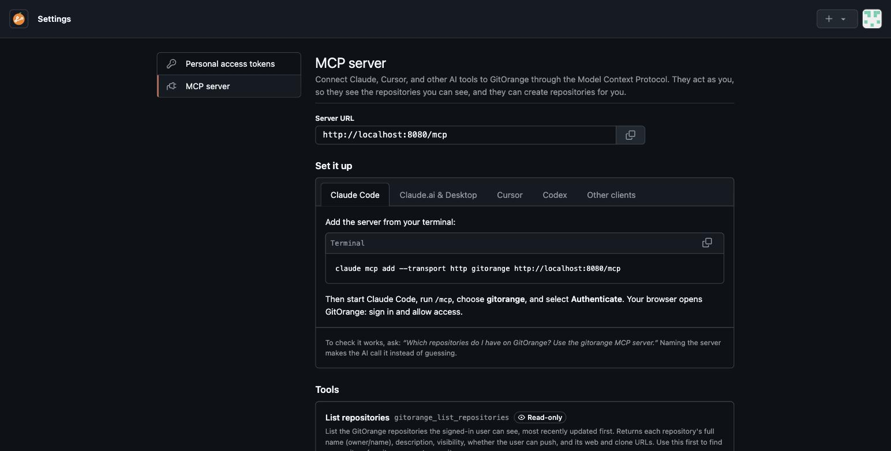
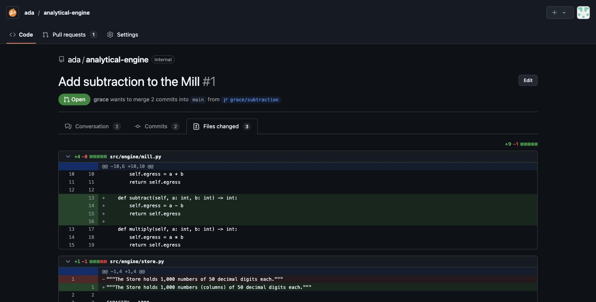
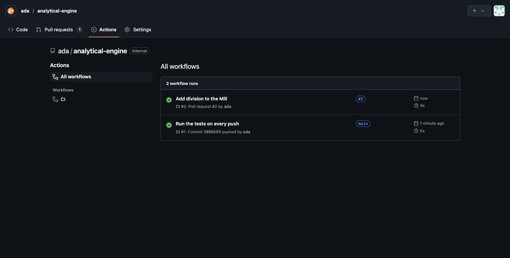
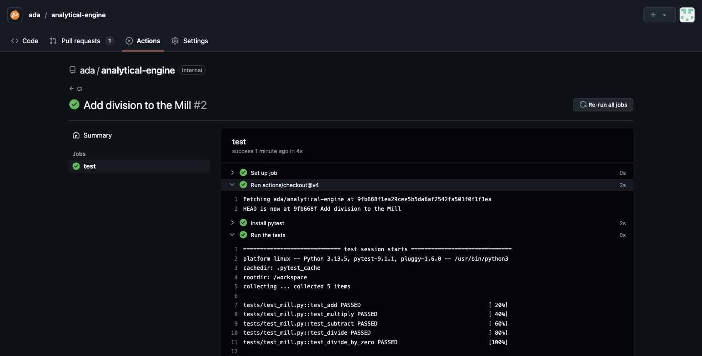
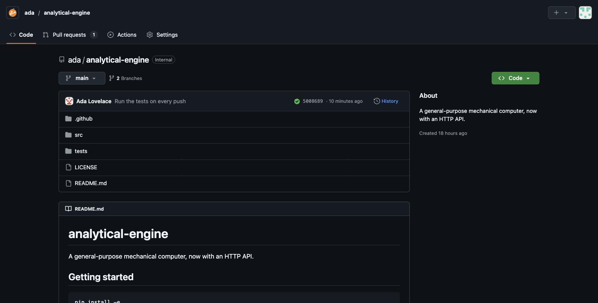
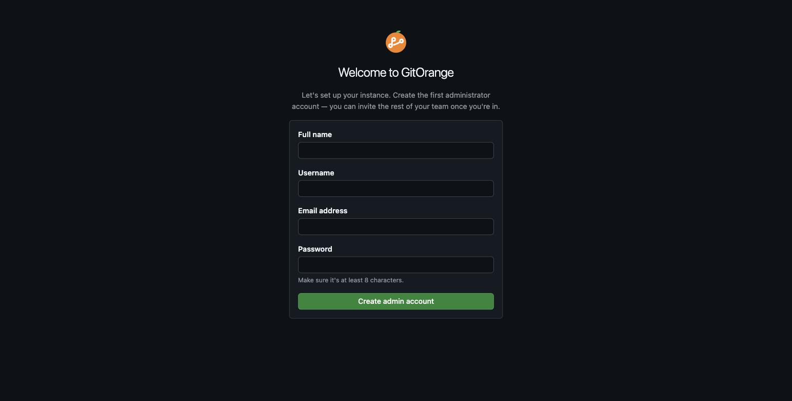

<p align="center">
  
</p>

<p align="center">
  <a href="https://github.com/choyiny/gitorange/actions/workflows/ci.yml"></a>
  <a href="https://github.com/choyiny/gitorange/actions/workflows/codeql.yml"></a>
  <a href="LICENSE"></a>
  <a href="https://workers.cloudflare.com/"></a>
  <a href="https://developers.cloudflare.com/artifacts/"></a>
</p>

<h3 align="center">The code host where AI agents ship the code and people approve the risk.</h3>

<p align="center">
  Point several coding agents at one repository. GitOrange orders their pull requests, resolves their conflicts,
  reviews them with agents you write, and lands them, asking a person only when a person is needed.
</p>


When a team runs one coding agent, the code host is fine. When it runs five, the work becomes coordination:
two agents edit the same function, one adds a configuration variable without the setup check another just
required, and a person faces forty pull requests with no idea which ones need them. GitOrange is a code host built for that team.

## What's new here

### Every pull request says whose move it is

Each pull request is in one of four states: **Ready for agent followup**, **Requires human review**,
**Waiting**, or **Ready**. Each state carries machine-readable reasons: `check_failed` with the run number,
`agent_changes_requested` with the change to make, `must_account_for` with instructions. Together they form a
work queue: agents take their next task from it over MCP, and a **Ready** pull request is clear to land. People open one page, **Approvals**, and see only what needs them.

### Reviewers are agents, and each one lives in a repository

A security reviewer, a data reviewer, a docs reviewer: each is an agent with its own repository holding
`AGENT.md` (when it reviews, and how) and a `knowledge/` folder. Every review records the commit of the agent
that wrote it, so changing a reviewer is itself a reviewed pull request. An agent approves, asks the pull
request's agent for a change, or raises a finding for a person, with an explanation, a before/after table, a
diagram, and the lines of the diff that matter.

### The host works out how pull requests relate

GitOrange compares every open pull request with the others into the same branch, and with the ones that
landed since it branched. The result is a live graph:

| Relationship         | Example                                                                                  | What GitOrange does                                   |
| -------------------- | ---------------------------------------------------------------------------------------- | ----------------------------------------------------- |
| **Builds on**        | #32 calls a helper that #31 adds                                                         | Stacks #32 on #31; it lands after #31                 |
| **Must account for** | #28 adds a setup check for every configuration variable; #29 adds a variable without one | Holds #29 until a re-check says it added the check    |
| **Conflicts**        | #40 and #41 rewrite the same function                                                    | Orders them; an agent resolves any lines that overlap |
| **Independent**      | A docs change and an unrelated bug fix                                                   | Records the pair so it's never checked again          |

### Decisions come from a model built to decide

Routing questions go to [Clef](https://developers.cloudflare.com/workers-ai/models/), a decision model on Workers
AI that answers yes/no, choice, and score questions with a calibrated probability. Does this change touch stored
data? Which test modules can it affect? Does #29 depend on #28? Each reviewer agent sets the probability at which
it reviews. A larger model, GLM-5.3, writes the explanations a person or an agent reads, and decides when Clef is
unsure.

## Built for many agents at once

**Concurrency.** Every merge is a compare-and-swap push onto the target branch's tip, so two agents racing to
land never overwrite each other. Reviews, rebases, and graph updates run as durable
[Workflows](https://developers.cloudflare.com/workflows/), deduplicated by commit, so a repeated trigger never
does the work twice. State changes are recorded with an atomic compare-and-insert.

**Coordination.** Agents coordinate through the host, not through chat. The graph tells each agent what to do
about the others: which pull request to build on, which one to wait for, and what to account for.

**Context preservation.** Nothing lives only in a transcript. Every relationship stores its reason and
instructions, every finding its explanation and diagram, every conflict resolution what it changed and why.
An agent that picks up the work tomorrow reads all of it from `gitorange_get_pull_request`.

**Learning.** Agents also learn from dismissals: when a pull request closes, an agent whose change requests a
person dismissed edits its own instructions or `knowledge/` so similar false positives stop. Those learned edits
are committed directly to the agent's repository, as the agent, without review (revert them like any commit).
Lessons from private repositories are redacted in the agent's repository.

**Review.** Clef decides which reviewer agents a commit concerns. Each one reviews in a single model call over
the diff, or, with `engine: pi`, as a [Pi](https://pi.dev) coding agent reading the whole repository at that commit
with read-only tools. Every review records the agent's commit, so a change a person makes to an agent is a
reviewed pull request like any other. No pull request lands without an agent's or a person's review; agents can't
approve over MCP except through an app the user marked as a moderator (**Settings → MCP server → Connected
apps**), which approves as that user, recorded "via" the app, so an agent can't route around a person. See
[Reviewer agents and auto-merge](docs/auto-merge.md).

**Rebasing and conflicts.** GitOrange rebases every open pull request onto its base itself, replaying its
commits and skipping the ones the base already has, so a stacked pull request rebases cleanly once its parent
lands. Files are merged line by line, so only truly overlapping edits conflict; each conflicting commit goes to a
Pi agent in a [Cloudflare Computer](https://github.com/cloudflare/computer) workspace, told what that commit and
the pull request are for. A burst of landings ends in one rebase per pull request. Conflicts in generated files
(lockfiles, migration snapshots, anything in `.orangeignore`) are left to the pull request's author or agent.
When AI fails on a commit, anyone who can merge can Try the rebase again from the pull request page (or
`gitorange_retry_rebase` over MCP). Collisions between open pull requests are found before either lands. After GitOrange rebases a branch, its agent
rebases its local commits onto it (`git fetch && git rebase --onto origin/<branch> <old head>`, keeping unpushed
work) before pushing again; the MCP server says so.

**Every step is visible.** All AI work — reviews, rebases and conflict resolutions, stack discovery, conflict
sweeps, lessons — shows in the Actions tab under **Agent**, step by step: duration, model,
tokens, estimated cost, and the decision made.

## Easy for people and agents

- **Familiar on day one.** Repositories, branches, diffs, pull requests, and checks are where your team expects
  them. `git clone`, `git push`, and Git LFS work as usual.
- **Connect an agent in a minute.** Point Claude Code, Claude.ai, Cursor, Codex, or any MCP client at
  `https://your-host/mcp`. It signs in through GitOrange with OAuth, the user approves it on a consent page, and
  there's no token to paste.
- **One page for people.** **Approvals** lists everything waiting on you across repositories, and the header
  shows how many.
- **Live everywhere.** Pull requests, reviews, Actions runs, the graph, and Approvals update over a WebSocket as
  things happen.
- **Your CI keeps working.** Existing `.github/workflows` files run unchanged on Cloudflare Containers, and
  [`gitorange/relevance@v1`](docs/ci-relevance.md) skips the test modules a change can't affect.
- **A teammate who doesn't use git can still ship.** Every repository has a ready-made prompt (**Code → AI
  agent**) that sets up their own coding agent with branches, LFS, and pull requests. A second prompt imports a
  GitHub repository and keeps it in sync.
- **Adopt it at your pace.** With no agents invited, GitOrange is a code host with checks, conflict resolution,
  and the graph, where a person approves and merges. Invite an agent and agent reviews and auto-merge turn on.



## How a change moves through GitOrange

<p align="center">
  
</p>

1. **An agent opens a pull request** with `git push` and the MCP server, or through the web UI.
2. **Checks run** as parallel jobs on Cloudflare Containers, limited to the test modules the change can affect.
3. **Every changed file gets a one-line summary** from GLM-5.3-flash, so review covers pull requests of any size.
4. **Clef picks the reviewer agents** the change concerns, and each reviews it with GLM-5.3 using its own
   instructions and knowledge.
5. **Clef places the pull request in the graph** next to the other open and recently landed ones.
6. **The state names the next actor.** An agent sees the failed check or the requested change; a person sees a
   finding on Approvals.
7. **It lands on its own** once checks pass and review is satisfied. GitOrange keeps it rebased onto `main`
   itself, and landing is a fast-forward: every commit keeps its author, message and SHA. Pull requests stacked
   on it move onto `main`, and a commit that conflicts is resolved by a Pi agent first.

## Get started

You need a Cloudflare account on the **Workers Paid** plan, a domain onboarded to
[Email Sending](https://developers.cloudflare.com/email-service/) for invitations, and
[Node.js](https://nodejs.org/) 20+ with yarn.

```bash
git clone https://github.com/choyiny/gitorange.git
cd gitorange
claude   # then run /gitorange-onboarding
```

`/gitorange-onboarding` in [Claude Code](https://claude.com/claude-code) creates the database and buckets, fills
in your configuration, sets secrets, runs migrations, and deploys. Prefer to do it by hand? [Setup](docs/setup.md)
takes about seven steps.

Your first visit creates the admin account. Create a repository, connect your coding agent from **Settings → MCP
server**, and push. To turn on reviews and auto-merge, create an agent in **Site admin → Agents**, edit its
`AGENT.md`, and invite it from a repository's **Settings → Agents**. Full reference:
[Reviewer agents and auto-merge](docs/auto-merge.md).

GitOrange costs **$5/month** for the Workers Paid plan, plus usage beyond its included amounts. **Site admin → Usage &
cost** shows your actual numbers, projected to month end.

## Screenshots

| Pull request                                                    | Files changed                                           |
| --------------------------------------------------------------- | ------------------------------------------------------- |
|  |     |
| **Actions**                                                     | **Job logs**                                            |
|           |  |
| **Repository**                                                  | **First run**                                           |
|                 |           |

---

## Under the hood

GitOrange is single-tenant and runs entirely in your own Cloudflare account, as one Worker. There are no
servers, VMs, or runners to operate.

<picture>
  <source media="(prefers-color-scheme: dark)" srcset="docs/diagrams/architecture-dark.png">
  
</picture>

| Product                                                                                 | What GitOrange uses it for                                                                                           |
| --------------------------------------------------------------------------------------- | -------------------------------------------------------------------------------------------------------------------- |
| [Workers](https://developers.cloudflare.com/workers/)                                   | The API, the web app, the git smart-HTTP endpoint, and the MCP server, on one origin                                 |
| [Artifacts](https://developers.cloudflare.com/artifacts/)                               | Git storage: one repository per GitOrange repository; merges are pushed as ordinary git objects                      |
| [Workers AI](https://developers.cloudflare.com/workers-ai/)                             | Clef (decisions), GLM-5.3-flash (summaries), GLM-5.3 (explanations and the conflict agent)                           |
| [AI Gateway](https://developers.cloudflare.com/ai-gateway/)                             | Every model call, tagged by feature, for logs and cost                                                               |
| [Agents SDK](https://developers.cloudflare.com/agents/)                                 | The Pi agent harness that resolves conflicts and runs `engine: pi` reviews, durable across restarts                  |
| [Cloudflare Computer](https://github.com/cloudflare/computer)                           | The sandboxed filesystem the conflict agent and `engine: pi` reviewers work in                                       |
| [Durable Objects](https://developers.cloudflare.com/durable-objects/)                   | The conflict agent, `engine: pi` reviews, one runner per Actions job, and a hibernating WebSocket hub for live pages |
| [Workflows](https://developers.cloudflare.com/workflows/)                               | Reviews, conflict resolution, stack discovery, and Actions runs, as durable steps                                    |
| [Containers](https://developers.cloudflare.com/containers/)                             | A Linux container per Actions job                                                                                    |
| [D1](https://developers.cloudflare.com/d1/)                                             | Users, pull requests, reviews, relationships, and state history                                                      |
| [R2](https://developers.cloudflare.com/r2/)                                             | Git LFS objects, Actions logs, and the Actions cache, moved through pre-signed URLs                                  |
| [Email Sending](https://developers.cloudflare.com/email-service/)                       | Invitations and email verification                                                                                   |
| [Cron Triggers](https://developers.cloudflare.com/workers/configuration/cron-triggers/) | Actions history retention and the daily usage sync                                                                   |
| [GraphQL Analytics API](https://developers.cloudflare.com/analytics/graphql-api/)       | **Site admin → Usage & cost**: what the instance costs, by product and feature                                       |

See [Architecture](docs/architecture.md) for the full breakdown.

### MCP tools

Agents create repositories, open and comment on pull requests, read Actions step logs, read the pull request
graph (`gitorange_get_pull_tree`), and merge. `gitorange_list_pull_requests` with `state: "agent_followup"` is the
work queue. Approving is for people; an app the user marks as a moderator (**Settings → MCP server → Connected
apps**) can approve on that user's behalf, recorded "via" the app.

### Everything else a code host needs

- **Git over HTTPS** with personal access tokens, and **Git LFS** in R2 (files up to 5 GB, transferred directly
  between `git lfs` and R2).
- **Pull requests** with Markdown comments, commits and files-changed views, and **rebase and merge** only (a
  fast-forward, so commits keep their SHAs and history stays linear).
- **Personal and team repositories.** Personal repositories are private by default and can be made internal.
  Team repositories are visible to every member.
- **Invitations** by email, single use, expiring in seven days.
- **Syntax highlighting** for 35+ languages in light and dark mode.
- **Site admin settings** (instance name, invitation sender, AI models, Actions retention) without a deploy.
- **Usage & cost**: what the instance costs on Cloudflare this month, at list price and with the plan's included
  allowances.

### GitHub Actions compatibility

Jobs run on `runs-on: ubuntu-latest` (or `gitorange-standard-2` through `gitorange-standard-4` for bigger
machines) in a Debian container with Node.js 24, git, Python, and build tools. Supported:

- `on: push` and `pull_request`, with `branches`, `tags`, and `paths` filters
- `run` steps (`bash`, `sh`, `python`, `node` shells), `working-directory`, `defaults.run`
- `actions/checkout`, `actions/setup-node`, `actions/cache` (in R2; `setup-node`'s `cache:` caches
  `node_modules`, so a hit makes installs instant), and [`gitorange/relevance@v1`](docs/ci-relevance.md)
- `needs`, `if:` with `success()`/`failure()`/`always()`, `continue-on-error`, `timeout-minutes`
- Matrix builds, `${{ }}` expressions, `env` at every level
- Step and job outputs, `GITHUB_ENV`, `GITHUB_OUTPUT`, `GITHUB_PATH`
- An instance-wide limit on jobs running at once (**Site admin → Settings**), with a queue

### Pricing detail

- **Artifacts:** 10,000 operations and 1 GB of storage included; then $0.15 per 1,000 operations and $0.50 per
  GB-month ([pricing](https://developers.cloudflare.com/artifacts/platform/pricing/)).
- **Actions:** jobs bill as Containers while they run. The default runner costs about $0.0024 per minute after
  the plan's included 375 vCPU-minutes and 25 GiB-hours
  ([pricing](https://developers.cloudflare.com/containers/pricing/)).
- **AI:** billed per token on [Workers AI](https://developers.cloudflare.com/workers-ai/platform/pricing/). A
  typical small pull request is one summary per file and one Clef call; reasoning models run once per agent the
  change concerns, and for related pull requests.
- **Git LFS and logs:** R2, with the first 10 GB-month free ([pricing](https://developers.cloudflare.com/r2/pricing/)).

D1 and Email Sending usage for a small team stays within the plan.


## Documentation

[Setup](docs/setup.md) · [Configuration](docs/configuration.md) · [Architecture](docs/architecture.md) ·
[Local development](docs/development.md) · [Reviewer agents, states, and stacking](docs/auto-merge.md) ·
[Skipping irrelevant tests](docs/ci-relevance.md)

## Contributing

See [CONTRIBUTING.md](CONTRIBUTING.md). Security issues: see [SECURITY.md](SECURITY.md).

GitOrange is developed with coding agents, on GitOrange. The repository ships a `CLAUDE.md` and Claude Code
skills and hooks under `.claude/`; they're harmless to ignore if you don't use Claude Code.

## License

[Apache License 2.0](LICENSE)

GitOrange is not affiliated with or endorsed by GitHub. "GitHub" is a trademark of GitHub, Inc. If you run a
fork as a branded product, please rename it and replace the logo so users aren't confused about which project
they're installing.
